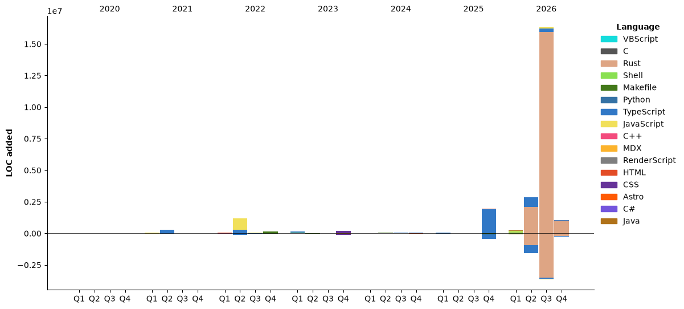

<div align="center">

# Daniel Netto

**Software Developer & Maker**

`🔧 Systems`&ensp;·&ensp;`⚡ Embedded`&ensp;·&ensp;`🌐 Web`&ensp;·&ensp;`🎮 Game Dev`

<br>

</div>

---

### 👨‍💻 About

- 🔭 Currently working on [Little App](https://github.com/dnettoRaw/littleApp) and [Primland](https://github.com/primland) projects
- 🌱 Learning **Unreal Engine** and diving deeper into **Rust**
- 💬 Ask me about **C, Shell Script, Arduino, Hardware Design**
- 📫 Reach me at **contact@dnetto.dev**
- 🌐 Portfolio at **[portfolio.dnetto.dev](https://portfolio.dnetto.dev)**

---

### 🛠️ Tech Stack

```
 Languages    C · C++ · C# · Rust · TypeScript · Python · Shell
 Frontend     React · Vue · Next.js · Nuxt · HTML · CSS · JS
 Backend      Node.js · .NET · REST · GraphQL
 Data         PostgreSQL · MongoDB · MySQL · SQLite · MSSQL
 Infra        Docker · AWS · Linux · Git
 Hardware     Arduino · Embedded Systems · PCB Design
 Engines      Unreal Engine · Electron
```

---

### 📊 GitHub Stats


<div align="center">
  
  <br/>
  
  <br/>
  
</div>

---

### 📅 Contributions

<div align="center">
  
</div>

---

### 🏆 Notable Contributions

<div align="center">
  
</div>

---

### 💡 Recent Activity

<div align="center">
  
</div>

---

### ⏱️ Weekly Dev Stats

<!--START_SECTION:waka-->


**🐱 My GitHub Data** 

> 📦 971.7 kB Used in GitHub's Storage 
 > 
> 🏆 2,543 Contributions in the Year 2026
 > 
> 🚫 Not Opted to Hire
 > 
> 📜 87 Public Repositories 
 > 
> 🔑 89 Private Repositories 
 > 
**I'm an Early 🐤** 

```text
🌞 Morning                5737 commits        ⣿⣿⣿⣿⣿⣿⣿⣀⣀⣀⣀⣀⣀⣀⣀⣀⣀⣀⣀⣀⣀⣀⣀⣀⣀   26.60 % 
🌆 Daytime                8185 commits        ⣿⣿⣿⣿⣿⣿⣿⣿⣿⣀⣀⣀⣀⣀⣀⣀⣀⣀⣀⣀⣀⣀⣀⣀⣀   37.95 % 
🌃 Evening                4807 commits        ⣿⣿⣿⣿⣿⣿⣀⣀⣀⣀⣀⣀⣀⣀⣀⣀⣀⣀⣀⣀⣀⣀⣀⣀⣀   22.29 % 
🌙 Night                  2841 commits        ⣿⣿⣿⣀⣀⣀⣀⣀⣀⣀⣀⣀⣀⣀⣀⣀⣀⣀⣀⣀⣀⣀⣀⣀⣀   13.17 % 
```
📅 **I'm Most Productive on Friday** 

```text
Monday                   2959 commits        ⣿⣿⣿⣀⣀⣀⣀⣀⣀⣀⣀⣀⣀⣀⣀⣀⣀⣀⣀⣀⣀⣀⣀⣀⣀   13.72 % 
Tuesday                  2738 commits        ⣿⣿⣿⣀⣀⣀⣀⣀⣀⣀⣀⣀⣀⣀⣀⣀⣀⣀⣀⣀⣀⣀⣀⣀⣀   12.69 % 
Wednesday                3264 commits        ⣿⣿⣿⣿⣀⣀⣀⣀⣀⣀⣀⣀⣀⣀⣀⣀⣀⣀⣀⣀⣀⣀⣀⣀⣀   15.13 % 
Thursday                 3425 commits        ⣿⣿⣿⣿⣀⣀⣀⣀⣀⣀⣀⣀⣀⣀⣀⣀⣀⣀⣀⣀⣀⣀⣀⣀⣀   15.88 % 
Friday                   5575 commits        ⣿⣿⣿⣿⣿⣿⣀⣀⣀⣀⣀⣀⣀⣀⣀⣀⣀⣀⣀⣀⣀⣀⣀⣀⣀   25.85 % 
Saturday                 2069 commits        ⣿⣿⣀⣀⣀⣀⣀⣀⣀⣀⣀⣀⣀⣀⣀⣀⣀⣀⣀⣀⣀⣀⣀⣀⣀   09.59 % 
Sunday                   1540 commits        ⣿⣿⣀⣀⣀⣀⣀⣀⣀⣀⣀⣀⣀⣀⣀⣀⣀⣀⣀⣀⣀⣀⣀⣀⣀   07.14 % 
```


📊 **This Week I Spent My Time On** 

```text
💬 Programming Languages: 
Other                    35 hrs 38 mins      ⣿⣿⣿⣿⣿⣿⣿⣿⣿⣿⣿⣿⣿⣿⣿⣿⣿⣀⣀⣀⣀⣀⣀⣀⣀   69.03 % 
Rust                     7 hrs 8 mins        ⣿⣿⣿⣀⣀⣀⣀⣀⣀⣀⣀⣀⣀⣀⣀⣀⣀⣀⣀⣀⣀⣀⣀⣀⣀   13.82 % 
Markdown                 3 hrs 56 mins       ⣿⣿⣀⣀⣀⣀⣀⣀⣀⣀⣀⣀⣀⣀⣀⣀⣀⣀⣀⣀⣀⣀⣀⣀⣀   07.63 % 
TypeScript               2 hrs 17 mins       ⣿⣀⣀⣀⣀⣀⣀⣀⣀⣀⣀⣀⣀⣀⣀⣀⣀⣀⣀⣀⣀⣀⣀⣀⣀   04.45 % 
Python                   1 hr 4 mins         ⣿⣀⣀⣀⣀⣀⣀⣀⣀⣀⣀⣀⣀⣀⣀⣀⣀⣀⣀⣀⣀⣀⣀⣀⣀   02.09 % 

🔥 Editors: 
Codex Vscode             45 hrs 54 mins      ⣿⣿⣿⣿⣿⣿⣿⣿⣿⣿⣿⣿⣿⣿⣿⣿⣿⣿⣿⣿⣿⣿⣀⣀⣀   88.89 % 
VS Code                  5 hrs 44 mins       ⣿⣿⣿⣀⣀⣀⣀⣀⣀⣀⣀⣀⣀⣀⣀⣀⣀⣀⣀⣀⣀⣀⣀⣀⣀   11.11 % 

💻 Operating System: 
Mac                      51 hrs 38 mins      ⣿⣿⣿⣿⣿⣿⣿⣿⣿⣿⣿⣿⣿⣿⣿⣿⣿⣿⣿⣿⣿⣿⣿⣿⣿   100.00 % 
```

🤖 **AI Coding This Week** 

```text
No AI Coding Activity Tracked This Week
```

**Timeline**




 Last Updated on 01/11/2026 07:21:02 UTC
<!--END_SECTION:waka-->

---

<div align="center">

### 🔗 Connect

📧 [contact@dnetto.dev](mailto:contact@dnetto.dev)&ensp;·&ensp;🌐 [Portfolio](https://portfolio.dnetto.dev)&ensp;·&ensp;💻 [GitHub](https://github.com/dnettoRaw)&ensp;·&ensp;📚 [Stack Overflow](https://stackoverflow.com/users/14931083)&ensp;·&ensp;✍️ [DEV](https://dev.to/dnettoraw)

---

<sub>◆ Open to collaborations on interesting projects · Not looking for hire ◆</sub>

</div>
